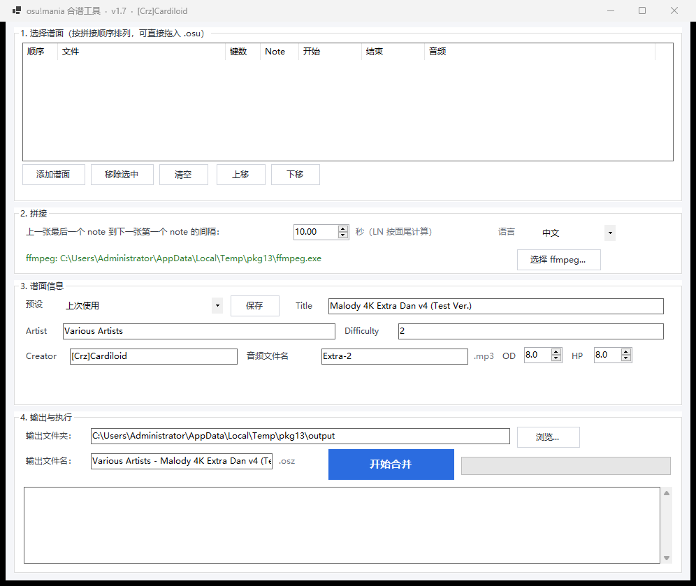

# osu!mania 合谱工具 / OsuManiaMerger

把多张 osu!mania 谱面首尾拼接成一张可以直接导入 osu! 的 `.osz`。

自带 .NET 8 运行时，Windows 10/11 64 位解压即用，不需要安装 .NET Framework。



> **English:** OsuManiaMerger merges multiple osu!mania charts into a single `.osz`.
> It keeps an exact, configurable gap between charts, preserves up to 5 seconds of
> intro/outro with smooth fades, and normalizes scroll speed against the globally
> longest BPM. The UI supports Chinese and English.

## 功能

- **精确间隔**：上一张最后一个 note（LN 按面尾）到下一张第一个 note，默认正好 10 秒，可调。
- **音频不硬切**：每首歌前后各最多保留 5 秒；超过 5 秒时只保留靠近 note 的 5 秒，并做 5 秒二次曲线渐入/渐出。
- **短音频补齐**：音频比最后一个 note 短时自动补静音，避免两段之间出现超长空白。
- **全局 SV 修正**：删除原绿线，按整首合并音频里累计持续时间最长的 BPM 作为全局基准，给每条红线生成对应 SV 绿线。
- **自定义元数据**：Title / Artist / Creator / Difficulty / 音频文件名。
- **OD / HP 可调**：0~10，步进 0.1，写入 `.osu`。
- **预设**：从第一张谱面读取、默认值、上次使用、自定义保存。
- **中英文切换**：界面、日志、弹窗、预设名全部跟随。
- **输出 `.osz`**：ZIP 内包含 `.osu` + `.mp3`，可直接拖进 osu!。

## 下载

去 [Releases](../../releases/latest) 下载 `OsuManiaMerger-win-x64.zip`，解压后：

1. 双击 `Start.bat`（会自动解除文件锁定），或直接双击 `OsuManiaMerger.exe`
2. 把 `.osu` 按顺序拖进窗口
3. 确认间隔（默认 10 秒）
4. 填写谱面信息、按需调 OD / HP
5. 点「开始合并」

输出默认在程序旁边的 `output` 文件夹，文件名默认是 `Artist - Title.osz`。

把 `.osz` 拖进 osu! 窗口，或放进 `osu!\Songs\` 后按 F5 刷新。

## 音频规则

| 情况 | 处理 |
|---|---|
| 第一首歌 | 完整保留前奏，不淡化 |
| 第 2 首起，第一个 note 距离音频开头 ≤ 5 秒 | 完整保留，不淡化 |
| 第 2 首起，第一个 note 距离音频开头 > 5 秒 | 只保留最后 5 秒，做 5 秒渐入 |
| 尾奏 ≤ 5 秒 | 完整保留，不淡化 |
| 尾奏 > 5 秒 | 只保留最后 note 之后的 5 秒，做 5 秒渐出 |

两段音频不会重叠；10 秒 note 间隔里不足的部分用静音补齐。
如果保留的 5 秒本身是纯静音，渐入听不出来是正常的——没有声音可以淡入。

## 全局 SV

1. 删除原谱所有绿线
2. 统计整首合并音频里每种 BPM 实际持续的总时间
3. 累计时间最长的 BPM = 全局基准 BPM
4. 每条红线处生成绿线：

```text
SV = 全局基准 BPM / 当前 BPM
```

例：基准 200，当前 250 → `0.80x`；当前 100 → `2.00x`；基准自己 → `1.00x`。

## 从源码构建

需要 [.NET 8 SDK](https://dotnet.microsoft.com/download/dotnet/8.0)。

```powershell
dotnet publish src/OsuManiaMerger.csproj -c Release -r win-x64 --self-contained true -o publish
```

或者直接运行仓库根目录的 `build.bat`（会调用 `scripts/build-release.ps1`，自动下载 ffmpeg 并打出 release zip）。

## 项目结构

```text
src/                 C# WinForms 源码
samples/             4 张 4K 示例谱 + 音频
packaging/           Start.bat、使用说明
scripts/             get-ffmpeg.ps1、build-release.ps1
.github/workflows/   tag 触发自动打包 Release
docs/                截图
```

## 常见问题

**提示 `This application could not be started`**
使用 Release 里的自包含版本；先解压到本地文件夹，再用 `Start.bat` 启动。不要直接在压缩包里双击。

**提示找不到 ffmpeg**
Release 包已附带 `ffmpeg.exe`。源码构建时运行 `scripts/get-ffmpeg.ps1`，或把 ffmpeg 放到 exe 旁边。

**键数不一致**
本工具按原轨道拼接，所有谱面的键数必须一致（例如都是 4K），不做 4K/7K 转换。

**为什么两首歌之间没有完整的 10 秒静音**
10 秒是 note 到 note 的间隔；前奏/尾奏会占用其中一部分，所以实际静音可能更短。

**原谱的绿线 / kiai 没了**
SV 修正会删除所有原绿线并重新生成，原谱用绿线做的演出会一并清掉。

## License

代码使用 [MIT License](LICENSE)。

Release 包内附带的 ffmpeg 为 GPL 许可，详见 [THIRD_PARTY_NOTICES.md](THIRD_PARTY_NOTICES.md)。
